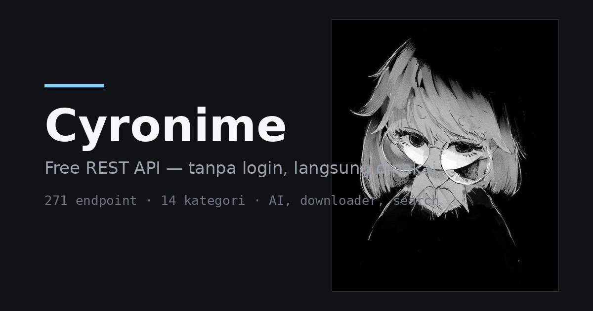

<div align="center">



# Aomi REST API

**197 endpoint publik gratis — tanpa API key, tanpa login, tinggal panggil.**

*Aomi: "Selamat datang di buku catatan API-ku! Semua endpoint di sini sudah kucatat rapi, tinggal buka dan pakai ya~"*

[](https://cyronime.my.id/docs)
[](https://cyronime.my.id/docs)
[](https://github.com/Rendyzzx)
[](#format-response)

**Docs** · [cyronime.my.id/docs](https://cyronime.my.id/docs)

</div>

---

## 📖 Tentang

**Aomi REST API** adalah koleksi REST API publik gratis yang dibuat dan dirawat oleh [RendyZ](https://github.com/Rendyzzx), dengan Aomi si maskot buku catatan sebagai pemandu dokumentasinya. Semua endpoint bisa dipakai langsung — cukup `GET`, tanpa registrasi, tanpa API key, tanpa limit harian.

Berjalan di [cyronime.my.id](https://cyronime.my.id), dilengkapi website dokumentasi bergaya *hand-drawn developer notebook* (dengan dark mode "Midnight Sketchbook") yang dilengkapi fitur **Try API** — coba request langsung dari halaman docs.

## 🚀 Mulai Cepat

Base URL:

```
https://cyronime.my.id/api/v1
```

Semua endpoint memakai `GET` dengan query parameter:

```bash
# Search YouTube
curl "https://cyronime.my.id/api/v1/s/youtube?query=lathi"

# Arti nama (primbon)
curl "https://cyronime.my.id/api/v1/primbon/artinama?nama=putu"

# Downloader TikTok
curl "https://cyronime.my.id/api/v1/d/tiktok?url=https://www.tiktok.com/@tiktok/video/7106594312292453126"

# AI chat
curl "https://cyronime.my.id/api/v1/ai/gpt?text=halo"

# Info gempa terkini (BMKG)
curl "https://cyronime.my.id/api/v1/info/gempa"
```

## 🗂️ Kategori Endpoint

| Kategori | Isi | Jumlah |
|---|---|:---:|
| **Canvas & Effects** | Kartu profil, welcome, efek visual — response gambar | 34 |
| **Games & Quiz** | Family100, caklontong, tebak gambar, dan kuis lain | 27 |
| **Anime** | Info anime & manga, Otakudesu, Samehadaku, Anichin | 26 |
| **Search** | YouTube, Pinterest, Spotify, Google, KBBI, dll. | 22 |
| **Downloader** | TikTok, Instagram, Facebook, Twitter/X, YouTube, Spotify, dll. | 21 |
| **Random** | Quote anime, neko, waifu, cecan | 13 |
| **AI & Chat** | GPT, DeepSeek, Qwen, GLM, Gemini, Meta AI, DuckAI | 11 |
| **Primbon** | Arti nama, ramalan jodoh, zodiak, tafsir mimpi, weton | 10 |
| **Berita & News** | CNN Indonesia, Liputan6, sumber nasional lain | 10 |
| **Stalker** | Profil publik GitHub, Instagram, TikTok, Twitter/X, YouTube | 8 |
| **Tools** | Translate, screenshot web, kode pos, subdomain, VCC | 6 |
| **Info** | Cuaca, gempa BMKG, jadwal TV, event Indonesia | 4 |
| **Maker** | photoOxy, ephoto360, textpro, brat | 4 |
| **Sticker** | Stiker Telegram (combot) | 1 |

Daftar lengkap parameter tiap endpoint tersedia di **[cyronime.my.id/docs](https://cyronime.my.id/docs)**.

## 📦 Format Response

Setiap response JSON membawa watermark **author RendyZ**.

```jsonc
// sukses
{
  "success": true,
  "author": "RendyZ",
  "data": { /* ... */ },
  "message": "Request berhasil",
  "meta": { "path": "/api/v1/s/youtube", "upstream_status": 200, "time_ms": 812 }
}

// error
{
  "success": false,
  "author": "RendyZ",
  "error": { "code": "VALIDATION_ERROR", "message": "...", "details": { } }
}
```

Kode error: `VALIDATION_ERROR` (400) · `URL_REJECTED` (400) · `ENDPOINT_NOT_FOUND` (404) · `METHOD_NOT_ALLOWED` (405) · `RATE_LIMITED` (429) · `UPSTREAM_ERROR` (502/503) · `UPSTREAM_TIMEOUT` (504).

Endpoint gambar (canvas, maker, sebagian random) mengembalikan binary asli dengan content-type aslinya.

## 🛡️ Keandalan & Keamanan

- **Fallback downloader bertingkat** — jika sebuah layanan sedang tidak bisa dihubungi, proxy otomatis mencoba jalur alternatif sebelum menyerah; response via fallback ditandai di `meta.fallback`.
- **Validasi input Zod** — tipe, wajib, enum, min/max; parameter di luar definisi diabaikan (allowlist).
- **SSRF guard** — hanya `http/https`, blokir IP loopback/private/link-local, verifikasi ulang setelah resolusi DNS.
- **Rate limiting** per IP (`RATE_LIMIT_PER_MINUTE`, default 40/menit) dan timeout per kategori request.
- **Read-only** — hanya `GET` yang dilayani; `POST/PUT/PATCH/DELETE` ditolak.

## 🧰 Stack

Next.js 15 (App Router) · TypeScript strict · Tailwind CSS v4 · Zod · Lucide React · Vercel.

## 💻 Menjalankan Lokal

```bash
npm install
npm run dev        # http://localhost:3000

# produksi
npm run build && npm start
```

Konfigurasi opsional via `.env.local` (lihat `.env.example`):

| Variabel | Default | Keterangan |
|---|---|---|
| `RATE_LIMIT_PER_MINUTE` | `40` | Batas request per menit per IP untuk `/api/v1/*` |
| `UPSTREAM_MAX_BYTES` | `4194304` | Batas ukuran response upstream yang diproses |

## 🩺 Health Check

```bash
curl https://cyronime.my.id/api/health
```

---

<div align="center">

**Dibuat dengan 📓 oleh [RendyZ](https://github.com/Rendyzzx)**

*Aomi: "Kalau ada endpoint yang error atau ide fitur baru, catat ke pembuatku ya! Sampai jumpa di halaman berikutnya~ ✦"*

</div>
